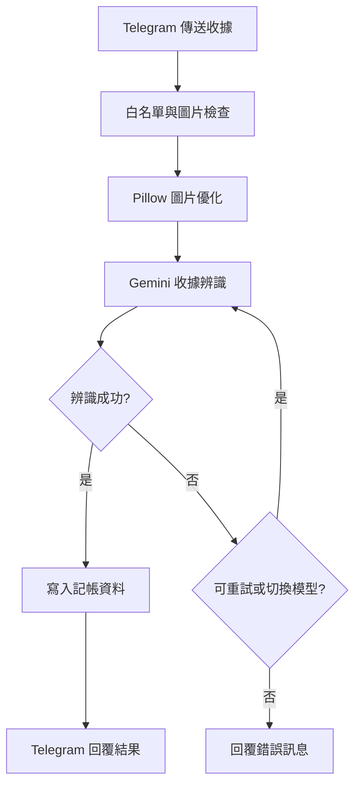

  

## 結論

使用 **Telegram Bot + Gemini API + Python + Render**，即可建立圖片自動辨識記帳系統。

現有 Python 架構建議優先保留 Render，搭配新加坡機房、UptimeRobot 監控及非同步處理，降低延遲與維護成本。

## 適合用在哪裡

- Telegram 群組旅遊分帳、日常支出紀錄。
- 收據圖片自動辨識，擷取店家、日期與金額。
- 整合 Google Sheets 或 Tricount 相關記帳流程。
- 已使用 Render 部署 Python Bot，希望改善效能。
## 流程步驟

### 1. 選擇部署平台

原始架構使用 Python、Pillow 及 Telegram Long Polling，因此優先評估既有程式的相容性與搬遷成本。

| 比較項目 | Render | Cloudflare Workers |
| --- | --- | --- |
| Python 支援 | 原生支援 | 有 Python Runtime，但相容性需確認 |
| Telegram 接收方式 | Long Polling / Webhook | Webhook |
| Pillow 圖片處理 | 直接使用 | 需評估套件支援 |
| 免費方案休眠 | 可能休眠 | 無傳統常駐服務休眠 |
| 搬遷成本 | 低 | 較高 |
| 適合情境 | 現有 Python Bot | 新建輕量 Webhook Bot |

**建議：** 現有專案繼續使用 Render，優先改善機房、圖片處理及 API 延遲。

若準備改寫 TypeScript Webhook，再考慮 Cloudflare Workers。

### 2. Telegram 權限與安全設定

為了讓機器人接收群組內的圖片，需要調整 Telegram 隱私模式。

1. 開啟 `@BotFather`，執行 `/setprivacy`。
1. 選擇 Bot，設定為 `Disable`。
1. 必要時將 Bot 移出群組後重新加入。
1. 使用 `chat_id`、`user_id` 白名單限制存取。
```python
# 僅允許指定群組使用
if update.effective_chat.id not in ALLOWED_CHAT_IDS:
    return
```

另外應先過濾非圖片訊息，避免不必要的 Gemini API 呼叫。

### 3. Render 部署與 UptimeRobot 防休眠

Render 免費 Web Service 在閒置一段時間後可能休眠，造成下一次 Telegram 操作等待較久。

可以在 Python Bot 加入 HTTP 健康檢查端點，提供外部監控工具定期存取。

```python
import os
import threading
from http.server import HTTPServer, BaseHTTPRequestHandler

class HealthHandler(BaseHTTPRequestHandler):
    def do_GET(self):
        self.send_response(200)
        self.end_headers()
        self.wfile.write(b"OK")

# 背景提供健康檢查，不阻塞 Telegram Bot
threading.Thread(
    target=lambda: HTTPServer(
        ("0.0.0.0", int(os.getenv("PORT", 8080))),
        HealthHandler
    ).serve_forever(),
    daemon=True
).start()
```

接著在 [UptimeRobot](https://uptimerobot.com/) 建立 HTTP(s) Monitor：

1. 登入 UptimeRobot Dashboard。
1. 點選 `Add New Monitor`。
1. Monitor Type 選擇 `HTTP(s)`。
1. URL 填入 Render 服務網址，例如 `https://your-bot.onrender.com`。
1. Monitoring Interval 設定為每 5 分鐘（依方案支援）。
1. 儲存設定，確認健康檢查回傳 HTTP 200。
**效果：**

UptimeRobot 定期發送 HTTP GET 請求，降低 Render 因閒置而休眠的機率。

但此方法不保證免費服務永久常駐，也無法避免平台維護、部署重啟或資源限制。

### 4. Gemini 辨識與效能優化

Telegram 圖片記帳的主要耗時通常集中在：

- 圖片下載。
- Pillow 圖片處理。
- Gemini 模型推論。
- Google Sheets / Tricount 記帳 API 寫入。
建議採取以下優化方式：

| 優化項目 | 建議方式 | 目的 |
| --- | --- | --- |
| 圖片大小 | 等比縮小至長邊約 1600～1920 px | 降低傳輸量 |
| 圖片品質 | JPEG Quality 約 85 | 減少圖片容量 |
| Gemini 配額 | HTTP 429 時切換可用模型 | 降低配額耗盡影響 |
| 非同步處理 | `asyncio.to_thread()` | 避免阻塞事件迴圈 |
| Telegram 回饋 | 先顯示「辨識中」 | 改善等待體驗 |

圖片處理可改為：

```python
import asyncio

# 將同步圖片處理移至執行緒
image_bytes = await asyncio.to_thread(
    optimize_receipt_image,
    raw_bytes
)
```

Telegram 收到圖片後，先顯示處理狀態：

```python
# 先通知使用者正在辨識
status = await update.message.reply_text(
    "收據辨識中..."
)

# 執行 Gemini 辨識與記帳寫入
# result_text = ...

# 完成後更新原本訊息
await status.edit_text(result_text)
```

此方式不會直接縮短 Gemini 推論時間，但可避免使用者誤以為 Bot 沒有回應。

## 流程圖



## 補充

### 1. Render 機房位置

若原本使用美東機房，可考慮重新建立 Singapore 服務。

- 新增 Render Web Service。
- Region 選擇 `Singapore`。
- 設定原本的 GitHub Repository 與環境變數。
- 部署成功後，停止舊服務。
**注意：** 不要讓兩個 Long Polling 實例同時執行，避免 Telegram 更新接收衝突。

### 2. 環境變數與重啟

Render 常用環境變數：

- `TELEGRAM_BOT_TOKEN`
- `GEMINI_API_KEY`
- `ALLOWED_CHAT_IDS`
修改環境變數後，確認 Render 是否已完成部署或重新啟動。

若需要手動重啟，可在 Render Dashboard 選擇 `Restart Service`。

### 3. Gemini 免費額度與模型備援

Gemini 模型名稱、免費額度及 RPM / RPD 限制會隨時間調整。

建議：

- 在 Google AI Studio 確認目前可用模型。
- 遇到 HTTP 429 時，依錯誤類型決定重試或切換模型。
- 不要將歷史免費額度或已停用模型寫死在程式中。
## 指令 / 範例整理

<details>
<summary>Click to expand</summary>

```plain text
Telegram Bot 隱私設定：
/setprivacy

Render 環境變數：
TELEGRAM_BOT_TOKEN
GEMINI_API_KEY
ALLOWED_CHAT_IDS

Render 健康檢查網址：
<https://your-bot.onrender.com>

UptimeRobot：
Monitor Type = HTTP(s)
Monitoring Interval = 5 minutes（依方案支援）
```

</details>

## 收尾

**現有 Python 記帳 Bot 不必為了追求速度就重寫架構。**

先處理 Render 休眠、圖片大小、同步阻塞及 Gemini API 延遲，通常比直接搬遷 Cloudflare Workers 更符合實務效益。

## 參考來源

- [https://render.com/docs](https://render.com/docs)
- [https://uptimerobot.com/](https://uptimerobot.com/)
- [https://core.telegram.org/bots/api](https://core.telegram.org/bots/api)
- [https://ai.google.dev/gemini-api/docs](https://ai.google.dev/gemini-api/docs)
- [https://developers.cloudflare.com/workers/](https://developers.cloudflare.com/workers/)
