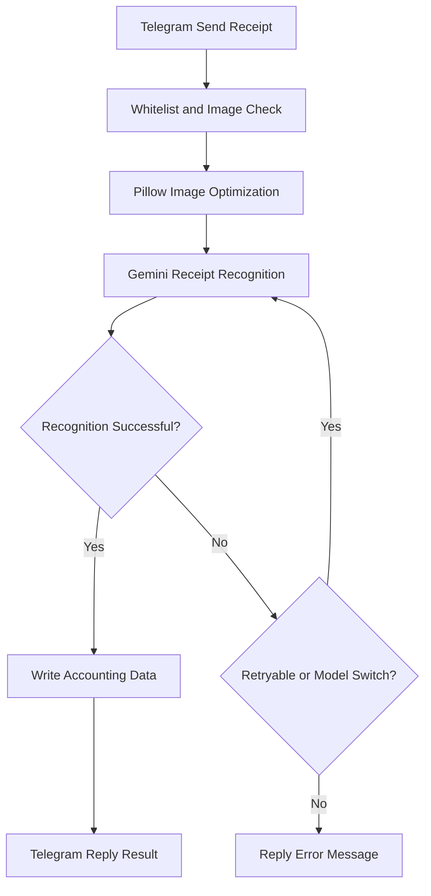

## Conclusion

By using **Telegram Bot + Gemini API + Python + Render**, you can create an automated image recognition accounting system.

For existing Python architectures, it's recommended to prioritize Render, combined with a Singapore data center, UptimeRobot monitoring, and asynchronous processing, to reduce latency and maintenance costs.

## Where It's Suitable

-   Telegram group travel expense splitting, daily expense tracking.
-   Automatic receipt image recognition, extracting merchant, date, and amount.
-   Integration with Google Sheets or Tricount-related accounting processes.
-   Already using Render to deploy a Python Bot and looking to improve performance.
## Workflow Steps

### 1. Choosing a Deployment Platform

The original architecture uses Python, Pillow, and Telegram Long Polling, so the priority is to evaluate the compatibility and migration cost of the existing code.

| Comparison Item | Render | Cloudflare Workers |
| --- | --- | --- |
| Python Support | Native support | Has Python Runtime, but compatibility needs verification |
| Telegram Reception Method | Long Polling / Webhook | Webhook |
| Pillow Image Processing | Direct use | Requires package support evaluation |
| Free Tier Sleep | May sleep | No traditional persistent service sleep |
| Migration Cost | Low | Higher |
| Suitable Scenario | Existing Python Bot | New lightweight Webhook Bot |

**Recommendation:** Continue using Render for existing projects, prioritizing improvements in data center location, image processing, and API latency.

If you plan to rewrite with TypeScript Webhook, then consider Cloudflare Workers.

### 2. Telegram Permissions and Security Settings

To allow the bot to receive images within a group, you need to adjust Telegram's privacy mode.

1.  Open `@BotFather` and execute `/setprivacy`.
2.  Select your Bot and set it to `Disable`.
3.  If necessary, remove the Bot from the group and re-add it.
4.  Use `chat_id` and `user_id` whitelists to restrict access.
```python
# Only allow specified groups to use the bot
if update.effective_chat.id not in ALLOWED_CHAT_IDS:
    return
```

Additionally, non-image messages should be filtered first to avoid unnecessary Gemini API calls.

### 3. Render Deployment and UptimeRobot Anti-Sleep

Render's free Web Service may go to sleep after a period of inactivity, causing longer waits for the next Telegram operation.

You can add an HTTP health check endpoint to your Python Bot to allow external monitoring tools to access it periodically.

```python
import os
import threading
from http.server import HTTPServer, BaseHTTPRequestHandler

class HealthHandler(BaseHTTPRequestHandler):
    def do_GET(self):
        self.send_response(200)
        self.end_headers()
        self.wfile.write(b"OK")

# Provide health checks in the background, not blocking the Telegram Bot
threading.Thread(
    target=lambda: HTTPServer(
        ("0.0.0.0", int(os.getenv("PORT", 8080))),
        HealthHandler
    ).serve_forever(),
    daemon=True
).start()
```

Next, create an HTTP(s) Monitor in [UptimeRobot](https://uptimerobot.com/):

1.  Log in to the UptimeRobot Dashboard.
2.  Click `Add New Monitor`.
3.  Select `HTTP(s)` for Monitor Type.
4.  Enter your Render service URL, e.g., `https://your-bot.onrender.com`.
5.  Set Monitoring Interval to every 5 minutes (depending on your plan).
6.  Save settings and confirm that the health check returns HTTP 200.
**Effect:**

UptimeRobot periodically sends HTTP GET requests, reducing the chance of Render going to sleep due to inactivity.

However, this method does not guarantee that free services will remain permanently active, nor does it prevent platform maintenance, deployment restarts, or resource limitations.

### 4. Gemini Recognition and Performance Optimization

Telegram image accounting's main time consumption usually focuses on:

-   Image download.
-   Pillow image processing.
-   Gemini model inference.
-   Google Sheets / Tricount accounting API write operations.

It is recommended to adopt the following optimization methods:

| Optimization Item | Recommended Method | Purpose |
| --- | --- | --- |
| Image Size | Proportionally scale down to a long edge of about 1600-1920 px | Reduce transmission volume |
| Image Quality | JPEG Quality around 85 | Reduce image file size |
| Gemini Quota | Switch to available models when HTTP 429 occurs | Reduce impact of quota exhaustion |
| Asynchronous Processing | `asyncio.to_thread()` | Avoid blocking the event loop |
| Telegram Feedback | Display "Recognizing..." first | Improve waiting experience |

Image processing can be changed to:

```python
import asyncio

# Move synchronous image processing to a thread
image_bytes = await asyncio.to_thread(
    optimize_receipt_image,
    raw_bytes
)
```

After Telegram receives the image, first display the processing status:

```python
# First notify the user that recognition is in progress
status = await update.message.reply_text(
    "Receipt recognition in progress..."
)

# Execute Gemini recognition and accounting write operations
# result_text = ...

# Update the original message after completion
await status.edit_text(result_text)
```

This method does not directly shorten Gemini inference time but prevents users from mistakenly thinking the Bot is unresponsive.

## Flowchart



## Additional Notes

### 1. Render Data Center Location

If you were originally using the US East data center, consider recreating the service in Singapore.

-   Add a new Render Web Service.
-   Select `Singapore` for Region.
-   Configure the original GitHub Repository and environment variables.
-   After successful deployment, stop the old service.
**Note:** Do not run two Long Polling instances simultaneously to avoid Telegram update reception conflicts.

### 2. Environment Variables and Restart

Common Render environment variables:

-   `TELEGRAM_BOT_TOKEN`
-   `GEMINI_API_KEY`
-   `ALLOWED_CHAT_IDS`

After modifying environment variables, confirm whether Render has completed deployment or restarted.

If a manual restart is needed, you can select `Restart Service` in the Render Dashboard.

### 3. Gemini Free Tier and Model Fallback

Gemini model names, free tier quotas, and RPM / RPD limits may change over time.

Recommendations:

-   Confirm currently available models in Google AI Studio.
-   When encountering HTTP 429, decide whether to retry or switch models based on the error type.
-   Do not hardcode historical free tier quotas or deprecated models in your code.
## Commands / Examples Summary

<details>
<summary>Click to expand</summary>

```plain text
Telegram Bot Privacy Settings:
/setprivacy

Render Environment Variables:
TELEGRAM_BOT_TOKEN
GEMINI_API_KEY
ALLOWED_CHAT_IDS

Render Health Check URL:
<https://your-bot.onrender.com>

UptimeRobot:
Monitor Type = HTTP(s)
Monitoring Interval = 5 minutes (depending on plan support)
```

</details>

## Conclusion

**There's no need to rewrite your existing Python accounting Bot's architecture just to chase speed.**

Addressing Render's sleep issues, image size, synchronous blocking, and Gemini API latency is usually more practical and beneficial than directly migrating to Cloudflare Workers.

## References

-   [https://render.com/docs](https://render.com/docs)
-   [https://uptimerobot.com/](https://uptimerobot.com/)
-   [https://core.telegram.org/bots/api](https://core.telegram.org/bots/api)
-   [https://ai.google.dev/gemini-api/docs](https://ai.google.dev/gemini-api/docs)
-   [https://developers.cloudflare.com/workers/](https://developers.cloudflare.com/workers/)
